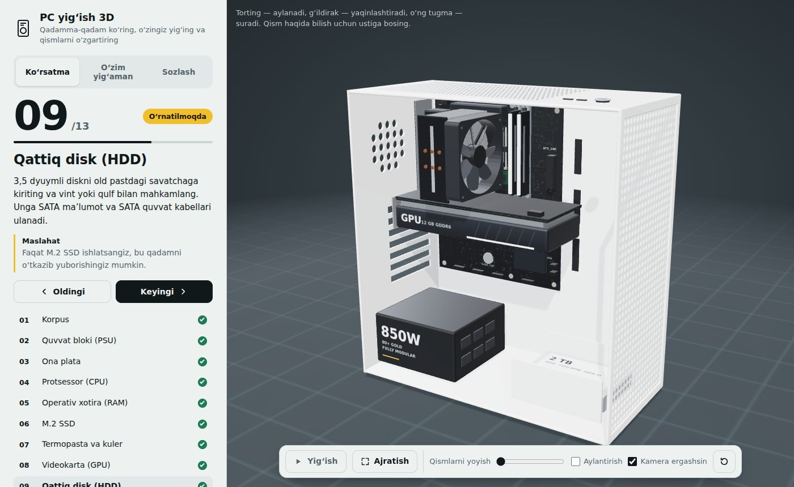
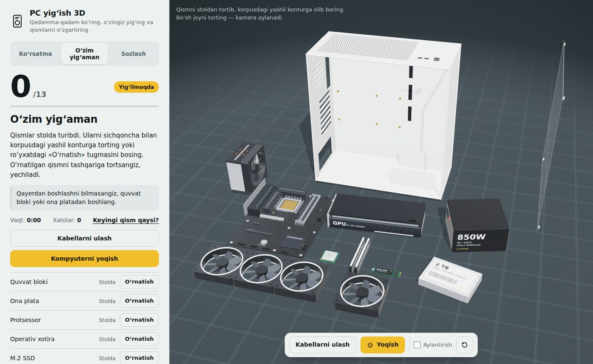

# PC yig‘ish 3D

Kompyuter qanday yig‘ilishi va qismlarga ajratilishini brauzerda 3D ko‘rsatadigan interaktiv sayt. Hammasi bitta `index.html` faylida: o‘rnatish, server yoki build kerak emas.



## Imkoniyatlar

**Ko‘rsatma.** Kompyuter 13 qadamda avtomatik yig‘iladi: korpus, quvvat bloki, ona plata, protsessor, RAM, M.2 SSD, termopasta va kuler, videokarta, HDD, ventilyatorlar, kabellar, shisha panel va yoqish. Har qadamda o‘rnatish va yechish bo‘yicha tushuntirish hamda maslahat bor. Qismlarni bir-biridan yoyib ko‘rsatish ham mumkin.

**O‘zim yig‘aman.** Qismlar stolda yotadi, foydalanuvchi ularni sichqoncha yoki barmoq bilan korpusga tortib o‘rnatadi. Tartib real hayotdagidek tekshiriladi, kabellar ulanadi, «Yoqish» tugmasi esa yig‘ilgan kompyuterni xato va ogohlantirishlar bo‘yicha tekshiradi. Vaqt va xatolar soni hisoblanadi.



**Sozlash.** Korpus rangi, RGB yoritish, videokarta, kuler, RAM va quvvat bloki variantlarini tanlash mumkin. Sayt tanlangan qismlarga qarab quvvat iste’molini hisoblaydi. Tanlovlar brauzerda saqlanadi.

## Ishga tushirish

`index.html` faylini brauzerda oching. 3D kutubxona CDN’dan yuklanadi, shuning uchun internet kerak.

## GitHub Pages’ga joylash

1. Repozitoriy sozlamalarida **Pages** bo‘limini oching.
2. Manba sifatida `main` branch va `/ (root)` papkani tanlang.
3. Bir-ikki daqiqadan so‘ng sayt `https://<foydalanuvchi>.github.io/pc-yigish-3d/` manzilida ochiladi.

## Texnologiyalar

- [three.js](https://threejs.org/) r128 (CDN orqali), `RoundedBoxGeometry` va `RoomEnvironment` qo‘shimchalari
- Oddiy HTML, CSS va JavaScript — framework yoki build bosqichi yo‘q
- 3D modellar kod orqali yasalgan, tashqi model fayllari ishlatilmagan

## Tuzilma

```
index.html     — butun sayt (HTML, CSS, JS)
docs/          — README uchun skrinshotlar
```
